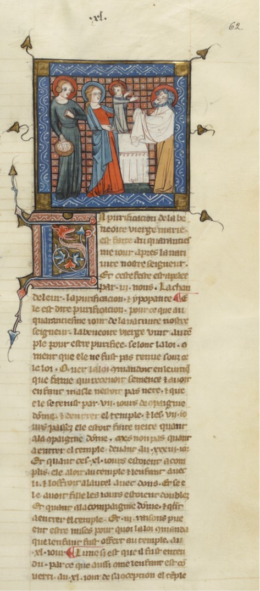
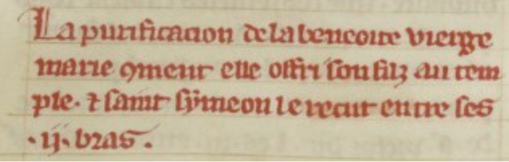
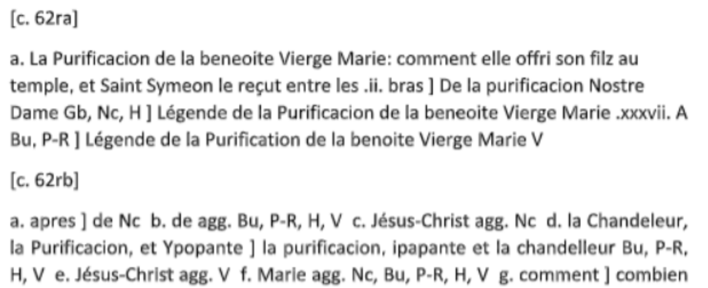
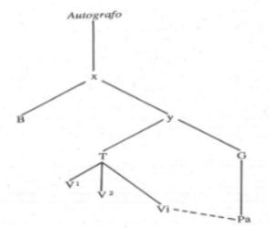
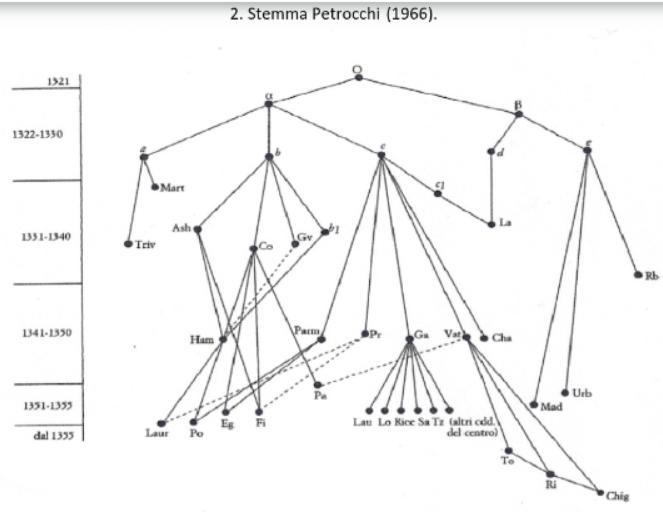
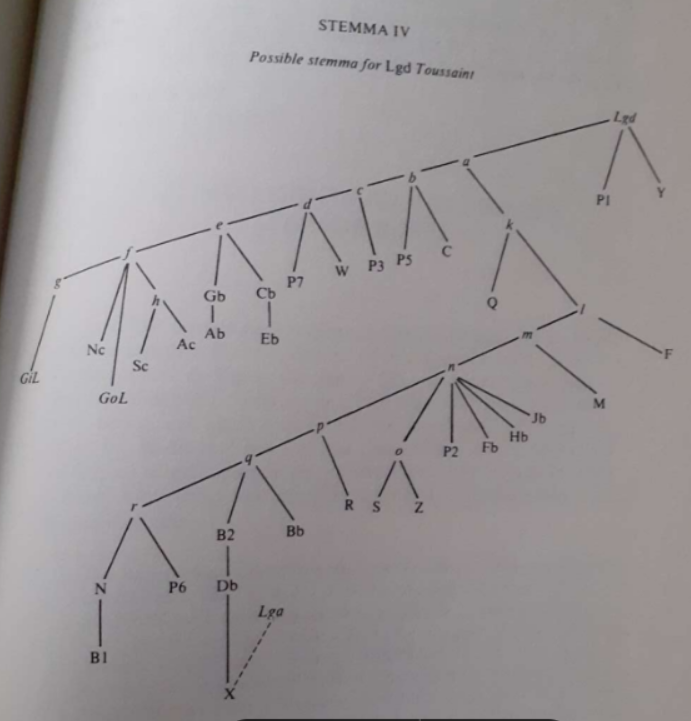

## Plan de la séance

- Définition
- Typologies d'édition
- Notions de base
- Numérique

# Avez-vous déjà entendu parler de philologie?

# Avez-vous déjà entendu parler de philologie?  Pouvez-vous en donner une définition?

## Définition

Philologie

[Philos: (gr. φίλος)](https://bailly.app/philos) aimé, cher; agréable, qui plaît; qui aime; (rare et en poésie) aimant, bienveillant. 

[Logos: (gr. λόγος)](https://bailly.app/logos) **parole**; une parole, un mot; une proposition; mention; bruit qui court; entretien; récit; composition en prose; belles-lettres, sciences, études; sujet d’entretien, d’étude ou de discussion; **raison**, faculté de raisonner; raison, bon sens; raison intime; exercice de la raison;  compte-rendu, justification, explication; opinion au sujet d’une chose à venir, présomption, attente; post. religieux et philosophique comme la raison divine ou le Verbe divin

# Pouvez-vous imaginer quelles sont les disciplines impliquées dans la construction du savoir phiologique?

## Pouvez-vous imaginer quelles sont les disciplines impliquées dans la construction du savoir phiologique?

:::{.incremental}
- Littérature
- Anthropologie
- Histoire
- Linguistique
- Études comparatistes
- Sociologie
:::

# Typologies d'édition

## Typologies d'édition: diplomatique
 

Édition diplomatique
 
 

Transcription, dite sèche, lorsqu'on transcrit un texte en le copiant en tan que tel sans aucune modification

## Typologies d'édition: facsimilie

::::{.columns}

:::{.column width="33%"}

:::

:::{.column width="33%"}

:::

:::{.column width="33%"}

:::

::::

## Typologies d'édition: diplomatique

::::{.columns}

:::{.column}

:::

:::{.column}

[c. 62rb] La purificacion de la beneoite vierge marie qment elle offri son filz au temple. z saint sÿmeon le reveut entre ses .ii. bras

La purificacion de la beneoite vierge marie est faite au quarantiesme iour apres la nativite nostre seigneur. Et ceste feste est apelee par .iii. nons. La chandeleur. la purificacion. z ypopante.
Ele est dite purificacion. pour ce que au quarantiesme iour de la nativite nostre seigneur: la beneoite vierge vint au tẽple pour estre purifiee.  selonc la loi,..

:::

::::

## Typologies d'édition: semi-diplomatique ou interprétative
 

Édition semi-diplomatique ou interprétative
 
 

La transcription présente des modifications, notamment orthographiques, pour insérer des dissimilations (u/v, i/j) ou pour réintégrer des accents pour désambiguïser les homographes.

## Typologies d'édition: diplomatique

::::{.columns}

:::{.column}

:::

:::{.column}

[c. 62rb] La purificacion de la beneoite Vierge Marie comment elle offri son filz au temple, et saint Sÿmeon le recut entre ses ii bras

La Purificacion de la beneoite Vierge Marie est faite au quarantiesme jour apres la Nativité nostre Seigneur. Et ceste feste est apelee par .iii. nons: la Chandeleur, la Purificacion, et Ypopante.
Ele est dite Purificacion, pour ce que au quarantiesme jour de la Nativité nostre Seigneur , la beneoite Vierge vint au temple pour estre purifiee,  selonc la loi,..

:::

::::

## Typologies d'édition: critique
 

Édition critique
 
 

Après les études des différents témoins, on constitue un texte, reposant sur un document spécifique (Joseph Bédier 1864-1938), ou texte visant la reconstitution d'un texte "originel" (Karl Lachmann 1793-1851). Ce texte est accompagné d'un apparat critique enregistrant les variantes

## Typologies d'édition: critique

## Typologies d'édition: génitique 
 

Édition génitique 
 
 

Ensemble des manuscrits du vivant de l'auteur ressemblé et étudié en fonction de la restitution de l'évolution du texte. 

# Notions de base

## Notions de base

:::{.incremental}
- _Recensio_: recensement de tous les manuscrits (ms/mss) ou éditions existantes d'une œuvre.

- _Conspectus Siglorum_ et _Fontium_: liste des sigles des mss et éditions utilisées dans l'apparat, avec leurs informations et leur description. 

- _Collatio_: l'étude des variantes.

- _Stemma codicum_: reconstruction de l'arbre généalogique d'une œuvre en établissant la distance et les relations parmi les témoins.
:::

## Notions de base

## Notions de base

## Notions de base

## Notions de base

:::{.incremental}
- Apparat critique: l'ensemble des variantes qui peuvent être recueillies à partir des témoins choisis pour composer une édition.

- _Omisit_ et _Addidit_: Un témoin peut présenter des omissions ou des ajouts par rapport à d'autres témoins. Les omissions peuvent être dues à des erreurs d'inattention ou à un acte conscient. Les ajouts peuvent être faits pour clarifier ou ajouter des informations nouvelles ou implicites.
:::

## Notions de base

:::{.incremental}
- Lacune: similaire à l'omission, mais dans ce cas, la partie du texte est plus importante, et pas seulement un mot ou une petite partie

- Glossaire: pour les textes les plus anciens, on fournit un glossaire des mots ou expressions qui ne sont plus utilisés ou ont évolués, afin de faciliter la compréhension. 
:::

# Numérique

## Numérique

XML-TEI

eXtensible Markup Language - [Text Encoding Initiative](https://tei-c.org/)

Découvrons les Guidelines de la TEI. 
